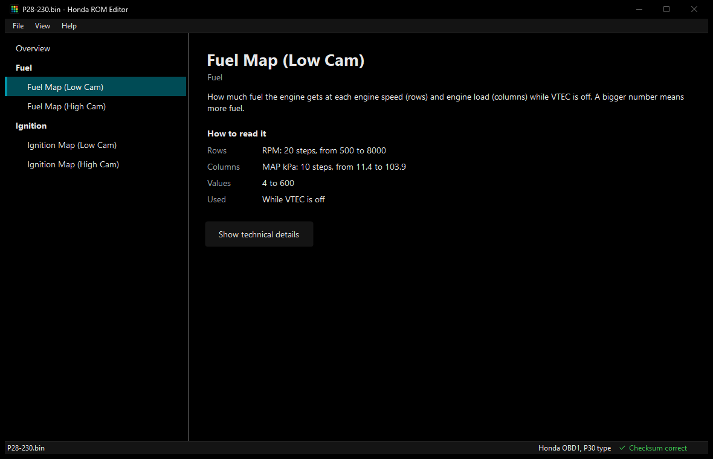

# Application

The editor is one window: a menu bar, a list of what the open ROM holds, a page that describes what is selected, and a status bar. It is built to the [[Design principles]]: usable with the keyboard alone and with a screen reader, in plain words, with the technical detail one command away.

Run it with `dotnet run --project src/HRE.App`, or start `HondaRomEditor.exe`. A ROM file given on the command line is opened.

> Early version. It opens ROM files for reading. It cannot change or save them yet.

## Starting

With no file open the page has the whole window. It offers, top to bottom: the button **Open a file...**, which has the keyboard focus; the files opened lately; what this version cannot do yet; what a ROM is; and the kinds of ROM this version can open.

## Opening a file

Three ways lead to the same thing: **File > Open...** (Ctrl+O) or the button on the start page; dropping a file anywhere on the window; **File > Recent files** or the list on the start page.

The program finds out by itself what kind of ROM the file is (see [[Supported ROMs]]). It is never asked of the user.

A file that is not opened leaves the window as it was and is explained above the page, with a button for the way on:

| What is wrong | What the window says |
|---|---|
| The file is gone | "... is no longer there. It may have been moved, renamed or deleted." It is also taken off the recent files |
| It is a folder | "... is a folder, not a file. Choose the ROM file inside it." |
| Another program holds it | "Another program is using ... Close it there, then try again." |
| Windows refuses | "Windows did not let this program read ..." |
| It is empty | "... is empty. The copy, the download or the read from the chip did not finish." |
| It is smaller than a ROM | "... is too small to be a ROM", with both sizes |
| It is far larger than a ROM | "... is too large to be a ROM". Such a file is not read at all |
| The right size, but no known ROM | "This version does not know the ROM in ...", with a link to the list of ROMs that open. The file's SHA-256 is in the technical details, for a report |

Opening never changes the file.

## The list

**Overview** comes first; under it the groups (Fuel, Ignition) with their tables and settings, in the order the description of the ROM gives them. The groups are always open. Pointing at an entry shows what it is.

| Selected | The page shows |
|---|---|
| Overview | What kind of ROM the file was recognised as; whether its checksum is correct, with what a checksum is; its size; what it holds, group by group; its add-ons and whether each is on |
| A group | Its tables and settings, each with its description |
| A table | What the table is, in a sentence; what its rows and columns stand for, how many steps each has and from where to where they run; the range of its values; whether the engine computer uses it with VTEC on or off |
| A setting | Its value with its unit, and from where to where it can be set |

## Technical details

**View > Technical details** (Ctrl+T), or the button at the foot of a page, shows on every page what only matters to someone working on the bytes: the full path, the SHA-256, the identifier of the ROM's description, the platform, the checksum rule, addresses, cell widths, scaling and how the steps of rows and columns are stored. The choice is remembered.

Every value on a page is a field that can be reached with Tab, selected and copied.

## Text size

**View > Larger text** (Ctrl++), **Smaller text** (Ctrl+-) and **Normal text size** (Ctrl+0) set the size of all text, from the normal size up to twice that. The list widens with it and pages grow taller. The choice is remembered.

## Keyboard

| Key | Does |
|---|---|
| Alt, then the underlined letter | Opens a menu; every command has a letter |
| Ctrl+O, Ctrl+W | Open a file, close it |
| F6, Shift+F6 | Moves between the list and the page |
| Tab, Shift+Tab | Moves through the fields and buttons of the page, and to the divider, which the arrow keys move |
| Page Up, Page Down, Ctrl+Home, Ctrl+End | Scroll the page |
| Ctrl+T | Technical details |
| Ctrl++, Ctrl+-, Ctrl+0 | Text size |
| F1 | Opens this page |

While a command is highlighted in a menu, the status bar says what it does.

## Status bar

| Field | Meaning |
|---|---|
| File | The name of the open file; the full path when pointed at. "No file open" otherwise |
| Kind of ROM | What the file was recognised as |
| Checksum | "Checksum correct", "Checksum wrong" or "No checksum" (some kinds of ROM have none), with a symbol and a colour that say the same |

## What is remembered

The place and size of the window, the width of the list, the text size, whether technical details are shown, and the eight files opened last. They are kept in `%AppData%\HondaRomEditor\settings.json`; deleting the file brings the defaults back. A place that is no longer on any screen is not restored.

## Windows contrast themes

When a Windows contrast theme is on, the window takes all its colours from it. Otherwise it has one look, black, and no setting to change it.

## Help menu

**Getting started** (F1) opens this page, **Which ROMs can be opened** opens [[Supported ROMs]], **Report a problem** opens the issue list. **About** shows the version and copies the versions of the program, .NET and Windows for a report.
